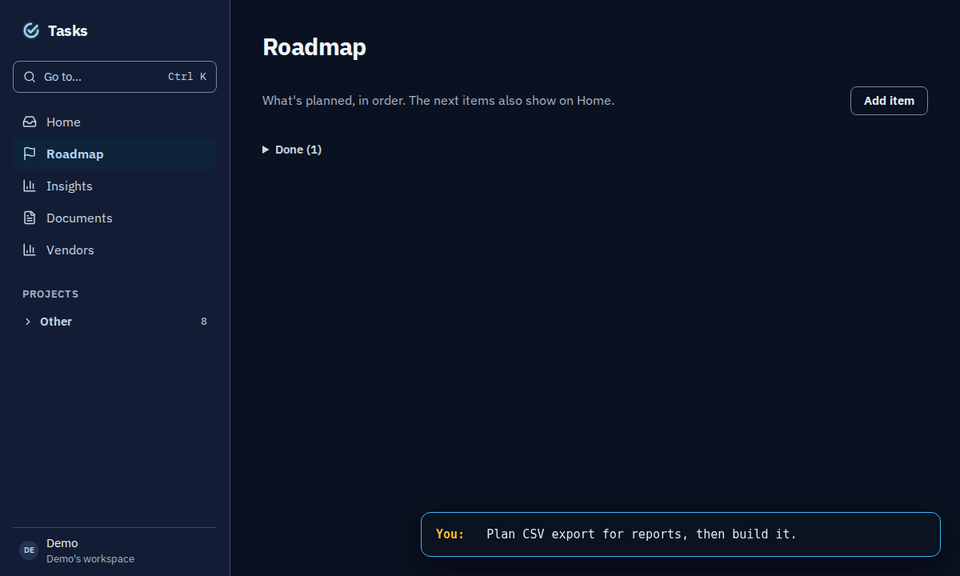
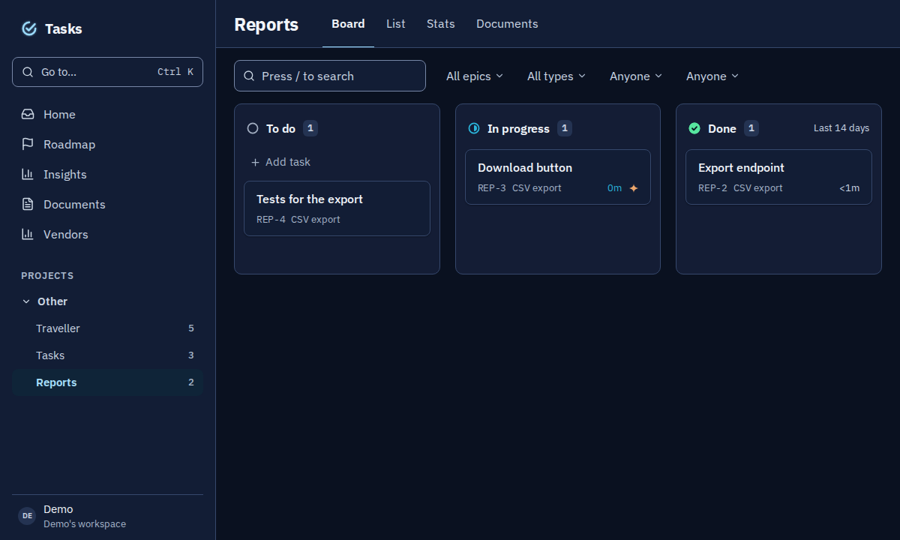

<p align="center"></p>

# Tasks: a documented development cycle for your AI agent

[](LICENSE)
[](CHANGELOG.md)


Your agent plans and builds the way a team does: **roadmap item → document → epic → tasks →
done**, all of it written down, and the next session picks it up where the last one stopped.

AI coding agents tend to jump straight to code, and what they decided is gone when the session
ends. With this plugin, your agent writes the plan as a document, breaks it into an epic and
tasks, keeps each task's status and next step current while it works, and closes the work when
it's done. A new session, another tool or a teammate reads that trail and carries on without you
explaining it again.

It works with [Tasks](https://tasks.vinguler.com), a web app where people and their agents keep
their work, or with plain markdown files in your project (local mode, no account).

## What it looks like

You ask for a feature; the agent runs the whole cycle in Tasks:

<p align="center"></p>

```text
You:   Plan CSV export for reports, then build it.

Agent: Added "CSV export" to the roadmap.
       Wrote DOC-11 "CSV export": why, scope, the open question on date formats. Please approve it.
You:   Approved. Use ISO dates.
Agent: Created epic REP-1 with three tasks: REP-2 export endpoint, REP-3 download button,
       REP-4 tests. Starting REP-2.
       ...
       REP-2 done (commit 3f2a91c). REP-3 in progress; its resume card says: button wired,
       next step is the empty-report message.

(next day, a new session)
You:   continue
Agent: Picked up from yesterday's handover: REP-3, next step the empty-report message.
```

Every step above is a real record in Tasks: the roadmap entry, the document with its approval,
the epic, the tasks with their notes, and the handover, linked to each other. The board in the
web app, mid-way through:

<p align="center"></p>

## Quick start

1. **Install** (pick your tool):

   | Claude Code | Codex CLI | Antigravity CLI |
   | --- | --- | --- |
   | `claude plugin marketplace add VinGuler/tasks-plugin`<br>`claude plugin install tasks@vinguler` | `codex plugin marketplace add VinGuler/tasks-plugin`<br>`codex plugin add tasks@vinguler` | `agy plugin install https://github.com/VinGuler/tasks-plugin` |

2. **Sign in** in a new session: in Claude Code run `/mcp`, pick `plugin:tasks:tasks`, choose
   **Authenticate**; in Codex run `codex mcp login tasks`; in Antigravity run `/mcp`, pick
   `tasks`. A browser opens: log in or sign up, pick the workspace, **Allow**. (Local mode skips
   this.)
3. **Ask your agent:** *"Let's use Tasks for this project. Plan &lt;your next feature&gt;."* The
   first time, it asks whether you want hosted Tasks or local mode.

Or let your AI tool install it: open this repository in it (or give it the link) and ask it to
install the plugin. [AGENTS.md](AGENTS.md) tells it the steps for its own tool.

## What you can ask your agent

- "Plan &lt;feature&gt;: write the document, then break it into an epic and tasks."
- "What's in progress?" / "What's on the roadmap?"
- "Pick up REP-22."
- "Log what you did on REP-21 and set it done."
- "Wrap up": it writes a handover for the next session.
- "Continue": a new session resumes from that handover.
- "Ask me when you need a decision": it files the question in Tasks and tells you.
- "Move this project to hosted Tasks" / "Take this workspace local."

## Words used here

- **Item:** a unit of work, an *epic*, a *task* or a *bug*, with a key such as `REP-21`.
- **Document:** a written plan or design. An epic starts from an approved document.
- **Resume card:** a few lines on an item saying where the work stopped and what comes next.
- **Handover:** the note `wrap-up` writes at the end of a session, so `continue` can start the next
  one on a clean context.
- **MCP:** Model Context Protocol, the standard way AI tools call outside services. Tasks is an
  MCP server; this plugin connects your tool to it.
- **Usage hook:** an optional script that tells Tasks how many tokens and how much time each item
  took. Counts only (see [Privacy](#privacy-and-permissions)).
- **Local mode:** the same way of working, kept as markdown files in your project's `.tasks/`
  folder. Nothing leaves your machine.

## The skills

| Skill | What it does |
| --- | --- |
| `tasks-workflow` | The way of working: the cycle, statuses, resume cards, notes, documents; the first-run setup. |
| `wrap-up` | Ends a session with a handover and up-to-date resume cards. |
| `continue` | Starts a session where the last one stopped. |
| `tasks-local` | The same way of working in markdown files under `.tasks/`, with no account. |
| `move-to-hosted` | Moves a local project into a Tasks workspace. |
| `move-to-local` | Takes a Tasks workspace export into the project as `.tasks/`. |

## Hosted or local

| | Hosted (tasks.vinguler.com) | Local (`.tasks/` markdown) |
| --- | --- | --- |
| Account | Yes (free) | None |
| Web app: board, roadmap, documents, activity | Yes | No: you read the files |
| Teammates and other tools on the same work | Yes | Through your repository, if you commit `.tasks/` |
| Time and tokens per item | Yes, with the usage hook | No |
| What leaves your machine | What your agent writes to Tasks, and usage counts if you agree | Nothing |

You can switch either way later with `move-to-hosted` or `move-to-local`.

## Privacy and permissions

- **What your agent can change:** only what you ask it to do in Tasks, in the one workspace you
  picked when you signed in. You can revoke that access any time in Tasks, under Settings › API
  tokens.
- **The usage hook is off until you agree.** The `tasks-workflow` skill asks on first use. If you
  say yes, it stores one report-only token in `~/.tasks/config.json`, readable by you only.
- **What the hook sends:** counts only: token numbers, the model name, session and agent ids, the
  item keys of Tasks' own status calls and the label your agent gave itself. **Never** prompts,
  replies, code, file paths or tool output. It reads the session transcript on your machine to
  count tokens (in Codex: the counts Codex hands its hooks; in Antigravity: the counts in its
  transcript), and keeps its progress in `~/.tasks/state/` (Codex: `~/.tasks/codex/`,
  Antigravity: `~/.tasks/agy/`).
- **How each tool runs the hook:** Claude Code and Antigravity run a plugin's hooks as installed;
  until you agree to usage reporting they do nothing. Codex runs them only after you trust them in
  `/hooks`.
- **Local mode** sends nothing anywhere.

The hooks are small Node scripts in [`hooks/`](hooks) (Node 18 or newer): read them before you
agree.

## What gets installed

| | Claude Code | Codex CLI | Antigravity CLI |
| --- | --- | --- | --- |
| The manifest the tool reads | `.claude-plugin/plugin.json` (marketplace: `.claude-plugin/marketplace.json`) | `.codex-plugin/plugin.json` | `.antigravity-plugin/plugin.json` |
| **Tasks MCP server** `https://tasks.vinguler.com/mcp`, browser log-in, no token to paste | `.mcp.json` | `.mcp.json` | `mcp_config.json` |
| **Skills** (the six above) | `skills/` | `skills/` | `skills/` |
| **Rules**: a short note telling the agent to use the skills | none | none | `rules/AGENTS.md` |
| **Usage hook** (optional) | `hooks/hooks.json` | `hooks/codex-hooks.json` | `hooks.json` |

Nothing else is installed. `AGENTS.md` holds the install steps for an AI tool asked to install the
plugin; `CLAUDE.md` only imports it, because Claude Code reads `CLAUDE.md` rather than `AGENTS.md`.

## Install details

### Claude Code (CLI and the Claude desktop app)

```sh
claude plugin marketplace add VinGuler/tasks-plugin
claude plugin install tasks@vinguler
```

Start a new session, run `/mcp`, pick `plugin:tasks:tasks` and choose **Authenticate**. The Claude
desktop app's Code sessions use the same setup, so they get the plugin too.

- Update: `claude plugin marketplace update vinguler && claude plugin update tasks@vinguler`
- Remove: `claude plugin uninstall tasks@vinguler && claude plugin marketplace remove vinguler`

### Codex CLI

```sh
codex plugin marketplace add VinGuler/tasks-plugin
codex plugin add tasks@vinguler
codex mcp login tasks
```

The last line opens the browser log-in. For usage reporting, start a new Codex session, run
`/hooks` and trust the Tasks hooks (`codex-hooks.json`). Codex marks them modified after every
plugin update, even when the hook files didn't change, and skips them silently until you trust
them again.

- Update: `codex plugin marketplace upgrade vinguler && codex plugin add tasks@vinguler`, then
  `/hooks` again.
- Remove: `codex plugin remove tasks@vinguler && codex plugin marketplace remove vinguler`

### Antigravity CLI (agy)

```sh
agy plugin install https://github.com/VinGuler/tasks-plugin
```

Start a session, run `/mcp`, pick `tasks` (it shows as needing a log-in) and sign in. The hook
runs at the end of each turn; `/hooks` lists it.

- Update: run the install line again.
- Remove: `agy plugin uninstall tasks`

### Local mode

Choose it when the `tasks-workflow` skill asks. It needs a tool that can read and write files in
your project (all three can). The MCP server stays configured but unused, so you can skip its
log-in. To move to hosted Tasks later, `move-to-hosted` zips `.tasks/` for Settings › Import; to
come back, every export (Settings › Export) carries the workspace as a `.tasks/` folder for
`move-to-local`.

### Updating

Updates are pull, not push: nothing changes on your machine until you run your tool's update
command, which gets the version on `main`. [CHANGELOG.md](CHANGELOG.md) says what changed. The
commands above are for Linux and macOS.

## FAQ

**Do I need an account?** Not for local mode. Hosted Tasks needs one; you can sign up from the
log-in page the plugin opens.

**What is sent to Tasks?** What your agent writes there at your request (items, notes, documents),
and, only if you agree, usage counts. Never your code, prompts or file paths. See
[Privacy and permissions](#privacy-and-permissions).

**What can my agent change?** Items, notes and documents in the one workspace you chose at sign-in.
Nothing outside it, and you can revoke the access at any time.

**What does it cost?** Nothing. Tasks is a free hobby project, with no paid plans: the plugin
(MIT-licensed), local mode and hosted Tasks alike.

**Which tools does it support?** Claude Code (CLI and desktop app), Codex CLI and Antigravity CLI,
on Linux and macOS. Others aren't supported yet.

**Can a team use it?** Yes, in hosted Tasks: everyone shares one workspace, each with their own
tool, and picks up each other's work.

## Support, security, contributing

- Questions and problems: [support@vinguler.com](mailto:support@vinguler.com) or a GitHub issue.
- Security problems: please don't open a public issue; see [SECURITY.md](SECURITY.md).
- Contributing: [CONTRIBUTING.md](CONTRIBUTING.md).
- Versions follow semver; the major version follows the MCP tool contract.

## License

[MIT](LICENSE)
